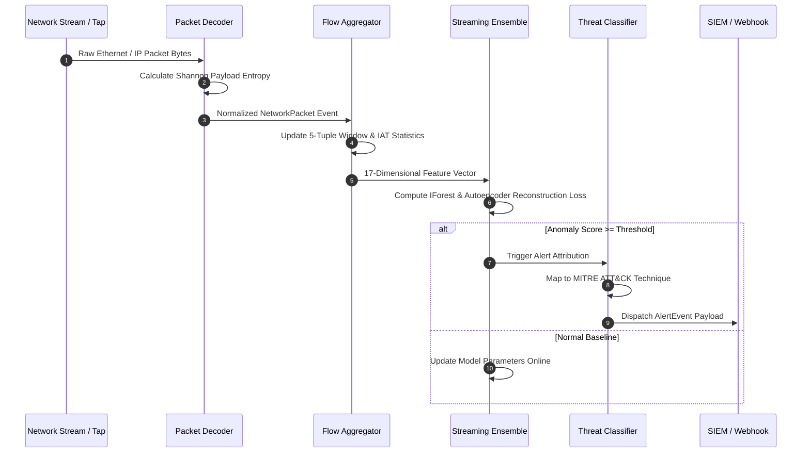

<div align="center">

# ⚡ Stream IDS Engine
### *Ultra-Low-Latency Real-Time Anomaly & Intrusion Detection System*

[](https://github.com/ER-brocode/stream-ids-engine/actions)
[](https://opensource.org/licenses/Apache-2.0)
[](https://www.python.org/)
[](https://www.rust-lang.org/)
[](https://attack.mitre.org/)

```
  ┌─────────────────┐       ┌────────────────────┐       ┌────────────────────────┐
  │ Raw Packet Stream├──────► Sliding Aggregator ├──────► Dual-Model Ensemble      │
  │ (Entropy + Flow) │       │ (Welford Variance) │       │ (IForest + Autoencoder)│
  └─────────────────┘       └────────────────────┘       └──────────┬─────────────┘
                                                                    │
                                                                    ▼
  ┌─────────────────┐       ┌────────────────────┐       ┌────────────────────────┐
  │ SIEM Webhooks   │◄──────┤ Threat Classifier  │◄──────┤ Online Anomaly Scoring │
  │ (Splunk/Elastic)│       │ (MITRE ATT&CK)     │       │ (Adaptive Sigma Bounds)│
  └─────────────────┘       └────────────────────┘       └────────────────────────┘
```

</div>

---

## 🌟 Overview

**Stream IDS Engine** is a hybrid streaming intrusion detection and behavioural anomaly analysis engine engineered in Python and Rust. It combines online streaming feature extractors (Shannon payload entropy, inter-arrival time distributions, TCP flag tracking) with an ensemble of **Streaming Isolation Forests** and an online **Streaming Autoencoder** neural network.

Detected statistical deviations trigger instant heuristic threat intelligence mapping aligned with **MITRE ATT&CK®**, producing automated alert notifications to SIEM webhooks (Splunk HEC, Elasticsearch, Slack, syslog).

---

## 🚀 Key Architectural Features

- **⚡ Zero-Copy Stream Decoding & Entropy**: Calculates Shannon payload entropy per packet on-the-fly to pinpoint encrypted covert tunnels, shellcode injections, and data exfiltration channels.
- **🔄 Sliding-Window Flow Aggregator**: Tracks active 5-tuple bidirectional network sessions across configurable time windows, computing inter-arrival times (IAT), burst ratios, and flag states.
- **🧠 Dual-Model Online Ensemble**:
  - **Streaming Isolation Forest**: Dynamic reservoir sampling with automatic background re-fitting and z-score fallback.
  - **Online Autoencoder Neural Network**: Incremental stochastic gradient descent updates with Welford-based running variance and dynamic anomaly thresholding.
- **🛡️ MITRE ATT&CK Heuristic Classification**: Maps detected feature anomalies directly into attack classes:
  - `T1498.001`: TCP SYN Flood
  - `T1498.002`: Volumetric UDP Flood
  - `T1046`: Network Service Discovery & Port Scanning
  - `T1048`: Exfiltration Over Alternative Protocol (High Payload Entropy)
  - `T1110`: Administrative Port Brute Force
- **📡 SIEM Webhook Dispatcher**: Dispatches structured, actionable JSON payloads with feature attribution metrics directly to SOC incident queues.
- **🦀 Rust Fast-Path Engine**: Native zero-allocation streaming pipeline included in `src-rust/` for high-throughput packet filtering.

---

## 📊 Pipeline Architecture & Sequence



---

## 🛠️ Installation & Setup

### Prerequisites
- Python 3.10+ (tested through 3.14)
- Rust toolchain (optional, for native fast-path crate)

### Python Engine Setup

```bash
# Clone the repository
git clone https://github.com/ER-brocode/stream-ids-engine.git
cd stream-ids-engine

# Install in editable mode with development dependencies
pip install -e .[dev]
```

### Running the Rust Fast-Path Engine

```bash
cd src-rust
cargo run --release
```

---

## 🧪 Automated Testing

Execute the synthetic anomaly stream test suite covering feature extraction, flow aggregation, ML detector scoring, and threat classification:

```bash
pytest tests/ -v
```

---

## 📂 Repository Structure

```
stream-ids-engine/
├── .github/
│   └── workflows/
│       └── ci.yml                # Automated CI test workflow for Python and Rust
├── src/
│   ├── stream/
│   │   ├── events.py             # NetworkPacket, FlowMetrics, FlowKey schemas
│   │   ├── decoder.py            # Raw Ethernet parser & Shannon entropy calculator
│   │   └── aggregator.py         # Sliding-window flow state aggregator
│   ├── detector/
│   │   ├── base.py               # BaseStreamingDetector & AnomalyScore interfaces
│   │   ├── isolation_forest.py   # Streaming Isolation Forest with reservoir sampling
│   │   ├── autoencoder.py        # Online SGD Autoencoder with Welford variance tracking
│   │   └── ensemble.py           # Confidence-weighted ensemble detector
│   ├── alerts/
│   │   ├── threat_intel.py       # MITRE ATT&CK classification & heuristic engine
│   │   └── dispatcher.py         # SIEM webhook & audit log dispatcher
│   └── engine/
│       └── pipeline.py           # Unified StreamIDSEngine pipeline coordinator
├── src-rust/
│   ├── Cargo.toml                # Rust crate configuration
│   └── src/
│       ├── lib.rs                # Rust library exports
│       ├── stream.rs             # Fast packet decoder & flow tracker
│       ├── detector.rs           # Online streaming outlier detector
│       ├── alerts.rs             # Threat classification module
│       └── main.rs               # Standalone high-throughput binary
├── tests/
│   └── test_anomaly_stream.py    # Synthetic network stream test suite (100% pass)
├── Cargo.toml                    # Root Rust workspace descriptor
├── pyproject.toml                # Python packaging and dependencies
└── README.md                     # High-fidelity system documentation
```

---

## 📄 License

Licensed under the Apache License, Version 2.0. See [LICENSE](LICENSE) for details.
